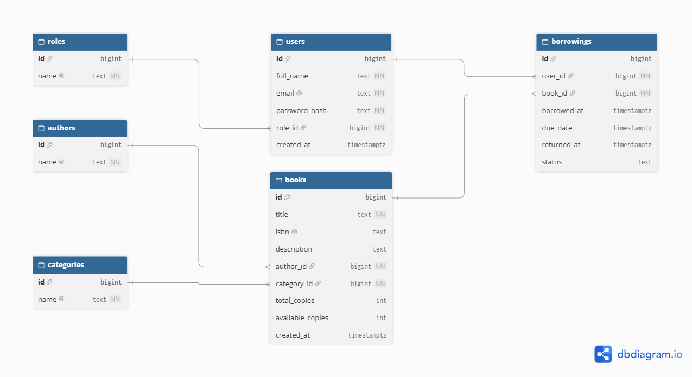

# Library Management System

REST API untuk pengelolaan perpustakaan yang mencakup manajemen buku, pengguna, kategori, penulis, serta aktivitas peminjaman dan pengembalian buku.

## A. Deskripsi Project

Library Management System adalah aplikasi backend berbasis REST API yang dirancang untuk membantu proses pengelolaan perpustakaan secara terstruktur. Sistem ini memungkinkan pengguna melihat daftar buku, mencari informasi buku berdasarkan ID, melakukan registrasi dan login, meminjam buku, melihat riwayat peminjaman, serta mengembalikan buku.

Sistem memiliki dua role utama, yaitu Admin dan User.

Admin bertanggung jawab mengelola data buku dan memantau seluruh aktivitas peminjaman. Admin memiliki akses untuk menambahkan, melihat, mengubah, dan menghapus data buku serta melihat seluruh riwayat peminjaman.

User dapat membuat akun, melakukan login, melihat daftar dan detail buku, meminjam buku yang tersedia, melihat riwayat peminjaman miliknya sendiri, dan mengembalikan buku yang sedang dipinjam.

Sistem menggunakan database relasional untuk menyimpan data pengguna, role, kategori, penulis, buku, dan riwayat peminjaman. Setiap peminjaman terhubung dengan satu pengguna dan satu buku melalui foreign key.

Setiap peminjaman memiliki batas waktu maksimal 14 hari sejak tanggal peminjaman. Apabila peminjaman melewati tanggal jatuh tempo, sistem menyediakan mekanisme pengembalian otomatis yang dapat dijalankan secara terjadwal melalui Vercel Cron Jobs. Ketika pengembalian otomatis berhasil diproses, status peminjaman diperbarui dan jumlah buku yang tersedia ditambah kembali.

Project ini berfokus pada pengembangan backend dan REST API. Frontend tidak termasuk dalam ruang lingkup implementasi.

## B. Tujuan Project

Project ini dikembangkan untuk:

- Menerapkan konsep REST API menggunakan HTTP Method GET, POST, PATCH, dan DELETE.
- Menerapkan database relasional dengan primary key dan foreign key.
- Mengimplementasikan registrasi, login, autentikasi JWT, dan otorisasi berdasarkan role.
- Mengelola data buku, kategori, dan informasi penulis.
- Mengelola proses peminjaman, pengembalian, dan riwayat transaksi buku.
- Menggunakan HTTP status code dan format JSON untuk request dan response API.
- Melakukan deployment backend agar dapat diakses melalui URL publik.
- Mendokumentasikan dan menguji endpoint menggunakan Thunder Client.

## C. Teknologi yang Digunakan

| Teknologi | Kegunaan |
|---|---|
| Node.js | Menjalankan JavaScript pada sisi backend |
| Express.js | Membuat server dan routing REST API |
| PostgreSQL | Menyimpan data dalam database relasional |
| Supabase | Menyediakan database PostgreSQL |
| Supabase JavaScript SDK | Menghubungkan backend dengan database |
| bcryptjs | Melakukan hashing dan verifikasi password |
| JSON Web Token (JWT) | Menangani token autentikasi pengguna |
| dotenv | Membaca konfigurasi environment pada lingkungan lokal |
| Git dan GitHub | Mengelola versi serta menyimpan source code |
| Vercel | Melakukan deployment REST API |
| Vercel Cron Jobs | Menjalankan pemeriksaan peminjaman yang melewati tanggal jatuh tempo |
| Thunder Client | Menguji request dan response API |

## D. Link Project

- GitHub Repository: https://github.com/MayyoSP/library-management-api
- Vercel Deployment: https://library-management-api-ten-taupe.vercel.app/

## E. Struktur Database

Database menggunakan PostgreSQL dengan enam tabel utama. Setiap tabel memiliki primary key dan tabel yang saling berkaitan dihubungkan melalui foreign key.

### 1. Tabel roles

Menyimpan jenis role yang tersedia dalam sistem.

| Kolom | Tipe | Keterangan |
|---|---|---|
| id | BIGINT | Primary key |
| name | TEXT | Nama role, yaitu admin atau user |

### 2. Tabel users

Menyimpan informasi akun pengguna.

| Kolom | Tipe | Keterangan |
|---|---|---|
| id | BIGINT | Primary key |
| full_name | TEXT | Nama lengkap pengguna |
| email | TEXT | Email unik pengguna |
| password_hash | TEXT | Password yang telah di-hash |
| role_id | BIGINT | Foreign key ke roles.id |
| created_at | TIMESTAMPTZ | Waktu pembuatan akun |

### 3. Tabel categories

Menyimpan kategori buku.

| Kolom | Tipe | Keterangan |
|---|---|---|
| id | BIGINT | Primary key |
| name | TEXT | Nama kategori yang unik |

### 4. Tabel authors

Menyimpan informasi penulis buku.

| Kolom | Tipe | Keterangan |
|---|---|---|
| id | BIGINT | Primary key |
| name | TEXT | Nama penulis yang unik |

### 5. Tabel books

Menyimpan informasi buku dan ketersediaan stok.

| Kolom | Tipe | Keterangan |
|---|---|---|
| id | BIGINT | Primary key |
| title | TEXT | Judul buku |
| isbn | TEXT | ISBN buku, bersifat unik jika diisi |
| description | TEXT | Deskripsi buku |
| author_id | BIGINT | Foreign key ke authors.id |
| category_id | BIGINT | Foreign key ke categories.id |
| total_copies | INTEGER | Jumlah seluruh eksemplar buku |
| available_copies | INTEGER | Jumlah eksemplar yang tersedia |
| created_at | TIMESTAMPTZ | Waktu penambahan buku |

### 6. Tabel borrowings

Menyimpan transaksi dan riwayat peminjaman buku.

| Kolom | Tipe | Keterangan |
|---|---|---|
| id | BIGINT | Primary key |
| user_id | BIGINT | Foreign key ke users.id |
| book_id | BIGINT | Foreign key ke books.id |
| borrowed_at | TIMESTAMPTZ | Waktu peminjaman |
| due_date | TIMESTAMPTZ | Tanggal jatuh tempo |
| returned_at | TIMESTAMPTZ | Waktu pengembalian |
| status | TEXT | Status peminjaman |

Status peminjaman yang digunakan:

- `borrowed`: buku sedang dipinjam.
- `returned`: buku telah dikembalikan oleh pengguna.
- `auto_returned`: peminjaman telah diselesaikan oleh mekanisme pengembalian otomatis.

### Relasi Antar Tabel

Relasi database pada Library Management System adalah sebagai berikut:

- `roles` ke `users`: one-to-many.
- `users` ke `borrowings`: one-to-many.
- `authors` ke `books`: one-to-many.
- `categories` ke `books`: one-to-many.
- `books` ke `borrowings`: one-to-many.

Relasi tersebut memungkinkan sistem menjaga hubungan antar data serta mencatat riwayat peminjaman secara terstruktur.

### ERD Database

ERD digunakan untuk menggambarkan struktur tabel, primary key, foreign key, dan relasi antar tabel pada database.



File gambar ERD disimpan di `screenshots/gambarERD.png`.

## F. REST API Documentation

Base URL:

https://library-management-api-ten-taupe.vercel.app

Seluruh endpoint menggunakan format JSON apabila request atau response mempunyai body JSON.

Untuk endpoint yang memerlukan autentikasi, token JWT harus dikirim melalui header:

`Authorization: Bearer TOKEN_JWT`

### 1. Informasi API

- Method: GET
- URL: `https://library-management-api-ten-taupe.vercel.app/`
- Deskripsi: Menampilkan informasi singkat API dan daftar beberapa endpoint utama.
- Headers: Tidak diperlukan.
- Request Body: Tidak diperlukan.

Response Sukses (200):

```json
{
  "message": "Library Management API berjalan.",
  "endpoints": {
    "books": "/api/books",
    "bookDetail": "/api/books/:id",
    "categories": "/api/categories",
    "authors": "/api/authors",
    "register": "/api/auth/register",
    "login": "/api/auth/login"
  }
}
```

### 2. Mendapatkan Semua Buku

- Method: GET
- URL: `https://library-management-api-ten-taupe.vercel.app/api/books`
- Deskripsi: Mengambil seluruh data buku beserta informasi penulis dan kategori.
- Headers: Tidak diperlukan.
- Request Body: Tidak diperlukan.

Response Sukses (200):

```json
{
  "data": [
    {
      "id": 1,
      "title": "Belajar Backend Development",
      "isbn": "9781234567890",
      "description": "Buku pengantar backend.",
      "author_id": 1,
      "category_id": 1,
      "total_copies": 3,
      "available_copies": 3,
      "author": {
        "id": 1,
        "name": "Budi Santoso"
      },
      "category": {
        "id": 1,
        "name": "Pemrograman"
      }
    }
  ]
}
```

Contoh data di atas merupakan ilustrasi. Data aktual berasal dari database.

### 3. Mendapatkan Detail Buku

- Method: GET
- URL: `https://library-management-api-ten-taupe.vercel.app/api/books/:id`
- Deskripsi: Mengambil detail buku berdasarkan ID.
- Headers: Tidak diperlukan.
- Request Body: Tidak diperlukan.

Contoh URL:

`https://library-management-api-ten-taupe.vercel.app/api/books/1`

Response Sukses (200): Mengembalikan objek `data` yang berisi detail buku.

Response Error (400):

```json
{
  "error": "ID harus berupa bilangan bulat positif."
}
```

Response Error (404):

```json
{
  "error": "Buku tidak ditemukan."
}
```

### 4. Menambahkan Buku

- Method: POST
- URL: `https://library-management-api-ten-taupe.vercel.app/api/books`
- Deskripsi: Menambahkan data buku baru ke database. Endpoint hanya dapat diakses oleh Admin.
- Headers:
  - `Content-Type: application/json`
  - `Authorization: Bearer TOKEN_ADMIN`

Request Body:

```json
{
  "title": "Belajar Backend Development",
  "isbn": "9781234567890",
  "description": "Buku pengantar pengembangan backend.",
  "author_id": 1,
  "category_id": 1,
  "total_copies": 5
}
```

Keterangan:

- `title` wajib diisi.
- `author_id` harus merujuk pada penulis yang tersedia.
- `category_id` harus merujuk pada kategori yang tersedia.
- `total_copies` harus berupa bilangan bulat minimal 1.
- `available_copies` ditentukan otomatis berdasarkan `total_copies`.

Response Sukses (201):

```json
{
  "message": "Buku berhasil ditambahkan.",
  "data": {
    "id": 1,
    "title": "Belajar Backend Development",
    "total_copies": 5,
    "available_copies": 5
  }
}
```

Response Error yang mungkin terjadi:

- `400 Bad Request`: input tidak valid atau relasi penulis/kategori tidak valid.
- `401 Unauthorized`: token tidak tersedia atau tidak valid.
- `403 Forbidden`: pengguna bukan Admin.
- `409 Conflict`: nilai unik seperti ISBN sudah digunakan.

### 5. Mengubah Data Buku

- Method: PATCH
- URL: `https://library-management-api-ten-taupe.vercel.app/api/books/:id`
- Deskripsi: Mengubah sebagian informasi buku. Endpoint hanya dapat diakses oleh Admin.
- Headers:
  - `Content-Type: application/json`
  - `Authorization: Bearer TOKEN_ADMIN`

Contoh URL:

`https://library-management-api-ten-taupe.vercel.app/api/books/1`

Request Body:

```json
{
  "title": "Belajar Backend Development Lanjutan",
  "description": "Edisi lanjutan pengembangan backend."
}
```

Field yang dapat diubah meliputi `title`, `isbn`, `description`, `author_id`, `category_id`, dan `total_copies`.

Response Sukses (200):

```json
{
  "message": "Buku berhasil diperbarui.",
  "data": {
    "id": 1,
    "title": "Belajar Backend Development Lanjutan"
  }
}
```

Response Error yang mungkin terjadi:

- `400 Bad Request`: ID atau data yang dikirim tidak valid.
- `401 Unauthorized`: token tidak tersedia atau tidak valid.
- `403 Forbidden`: pengguna bukan Admin.
- `404 Not Found`: buku tidak ditemukan.
- `409 Conflict`: nilai unik berbenturan dengan data yang sudah ada.

### 6. Menghapus Buku

- Method: DELETE
- URL: `https://library-management-api-ten-taupe.vercel.app/api/books/:id`
- Deskripsi: Menghapus data buku dari database. Endpoint hanya dapat diakses oleh Admin. Buku yang masih memiliki relasi peminjaman tidak dapat dihapus.
- Headers:
  - `Authorization: Bearer TOKEN_ADMIN`

Contoh URL:

`https://library-management-api-ten-taupe.vercel.app/api/books/1`

Request Body: Tidak diperlukan.

Response Sukses (200):

```json
{
  "message": "Buku berhasil dihapus."
}
```

Response Error yang mungkin terjadi:

- `400 Bad Request`: ID tidak valid.
- `401 Unauthorized`: token tidak tersedia atau tidak valid.
- `403 Forbidden`: pengguna bukan Admin.
- `404 Not Found`: buku tidak ditemukan.
- `409 Conflict`: buku masih memiliki relasi peminjaman.

### 7. Mendapatkan Semua Kategori

- Method: GET
- URL: `https://library-management-api-ten-taupe.vercel.app/api/categories`
- Deskripsi: Mengambil seluruh kategori buku yang tersedia.
- Headers: Tidak diperlukan.
- Request Body: Tidak diperlukan.

Response Sukses (200):

```json
{
  "data": [
    {
      "id": 1,
      "name": "Pemrograman"
    },
    {
      "id": 2,
      "name": "Novel"
    }
  ]
}
```

### 8. Mendapatkan Semua Penulis

- Method: GET
- URL: `https://library-management-api-ten-taupe.vercel.app/api/authors`
- Deskripsi: Mengambil seluruh data penulis yang tersedia.
- Headers: Tidak diperlukan.
- Request Body: Tidak diperlukan.

Response Sukses (200):

```json
{
  "data": [
    {
      "id": 1,
      "name": "Budi Santoso"
    },
    {
      "id": 2,
      "name": "Ayu Lestari"
    }
  ]
}
```

### 9. Registrasi Pengguna

- Method: POST
- URL: `https://library-management-api-ten-taupe.vercel.app/api/auth/register`
- Deskripsi: Mendaftarkan akun pengguna baru dengan role `user`.
- Headers:
  - `Content-Type: application/json`

Request Body:

```json
{
  "full_name": "Nama Pengguna",
  "email": "[EMAIL AKUN]",
  "password": "[PASSWORD AKUN]"
}
```

Ketentuan:

- Semua field wajib diisi.
- Email harus mempunyai format yang valid.
- Password minimal 8 karakter.
- Password disimpan sebagai hash menggunakan bcryptjs.
- Role ditentukan oleh server dan tidak dapat dipilih melalui request body.

Response Sukses (201):

```json
{
  "message": "Registrasi berhasil.",
  "data": {
    "id": 1,
    "full_name": "Nama Pengguna",
    "email": "[EMAIL AKUN]",
    "role_id": 2
  }
}
```

Response Error yang mungkin terjadi:

- `400 Bad Request`: input tidak lengkap, email tidak valid, atau password tidak memenuhi ketentuan.
- `409 Conflict`: email sudah terdaftar.

Password asli dan `password_hash` tidak dikirimkan dalam response.

### 10. Login Pengguna

- Method: POST
- URL: `https://library-management-api-ten-taupe.vercel.app/api/auth/login`
- Deskripsi: Memverifikasi kredensial pengguna dan menghasilkan JWT untuk autentikasi.
- Headers:
  - `Content-Type: application/json`

Request Body:

```json
{
  "email": "[EMAIL AKUN]",
  "password": "[PASSWORD AKUN]"
}
```

Response Sukses (200):

```json
{
  "message": "Login berhasil.",
  "token": "TOKEN_JWT_DARI_SERVER",
  "data": {
    "id": 1,
    "full_name": "Nama Pengguna",
    "email": "[EMAIL AKUN]",
    "role": "user"
  }
}
```

Response Error yang mungkin terjadi:

- `400 Bad Request`: email atau password belum diisi.
- `401 Unauthorized`: email atau password salah.

Token JWT digunakan pada endpoint yang memerlukan autentikasi. Jangan membagikan token yang masih berlaku.

### 11. Meminjam Buku

- Method: POST
- URL: `https://library-management-api-ten-taupe.vercel.app/api/borrowings`
- Deskripsi: Membuat transaksi peminjaman dan mengurangi stok buku yang tersedia.
- Headers:
  - `Content-Type: application/json`
  - `Authorization: Bearer TOKEN_USER`

Request Body:

```json
{
  "book_id": 1
}
```

`user_id` tidak dikirimkan melalui request body karena identitas peminjam berasal dari token yang telah diverifikasi.

Response Sukses (201):

```json
{
  "message": "Buku berhasil dipinjam.",
  "data": {
    "id": 1,
    "user_id": 1,
    "book_id": 1,
    "borrowed_at": "WAKTU_PEMINJAMAN",
    "due_date": "WAKTU_JATUH_TEMPO",
    "returned_at": null,
    "status": "borrowed"
  }
}
```

Response Error yang mungkin terjadi:

- `400 Bad Request`: `book_id` tidak valid.
- `401 Unauthorized`: token tidak valid atau tidak tersedia.
- `404 Not Found`: buku tidak ditemukan.
- `409 Conflict`: buku tidak tersedia untuk dipinjam.

Ketika transaksi berhasil, jumlah `available_copies` berkurang satu dan tanggal jatuh tempo ditetapkan 14 hari setelah peminjaman.

### 12. Melihat Riwayat Peminjaman Sendiri

- Method: GET
- URL: `https://library-management-api-ten-taupe.vercel.app/api/borrowings/me`
- Deskripsi: Mengambil riwayat peminjaman milik pengguna yang sedang login.
- Headers:
  - `Authorization: Bearer TOKEN_USER`
- Request Body: Tidak diperlukan.

Response Sukses (200):

```json
{
  "data": [
    {
      "id": 1,
      "borrowed_at": "WAKTU_PEMINJAMAN",
      "due_date": "WAKTU_JATUH_TEMPO",
      "returned_at": null,
      "status": "borrowed",
      "book": {
        "id": 1,
        "title": "Belajar Backend Development",
        "isbn": "9781234567890"
      }
    }
  ]
}
```

Endpoint ini hanya mengembalikan riwayat milik pengguna yang sedang login.

### 13. Mengembalikan Buku

- Method: PATCH
- URL: `https://library-management-api-ten-taupe.vercel.app/api/borrowings/:id/return`
- Deskripsi: Mengembalikan buku berdasarkan ID transaksi peminjaman.
- Headers:
  - `Authorization: Bearer TOKEN_USER`
- Request Body: Tidak diperlukan.

Contoh URL:

`https://library-management-api-ten-taupe.vercel.app/api/borrowings/1/return`

Response Sukses (200):

```json
{
  "message": "Buku berhasil dikembalikan.",
  "data": {
    "id": 1,
    "status": "returned",
    "returned_at": "WAKTU_PENGEMBALIAN"
  }
}
```

Response Error yang mungkin terjadi:

- `400 Bad Request`: ID peminjaman tidak valid.
- `401 Unauthorized`: token tidak valid atau tidak tersedia.
- `403 Forbidden`: transaksi bukan milik pengguna yang login.
- `404 Not Found`: data peminjaman tidak ditemukan.
- `409 Conflict`: peminjaman sudah selesai dikembalikan.

Setelah pengembalian berhasil, status berubah menjadi `returned`, `returned_at` diisi, dan jumlah buku tersedia bertambah satu.

### 14. Melihat Seluruh Peminjaman sebagai Admin

- Method: GET
- URL: `https://library-management-api-ten-taupe.vercel.app/api/admin/borrowings`
- Deskripsi: Mengambil seluruh riwayat peminjaman beserta informasi pengguna dan buku.
- Headers:
  - `Authorization: Bearer TOKEN_ADMIN`
- Request Body: Tidak diperlukan.

Response Sukses (200):

```json
{
  "data": [
    {
      "id": 1,
      "borrowed_at": "WAKTU_PEMINJAMAN",
      "due_date": "WAKTU_JATUH_TEMPO",
      "returned_at": null,
      "status": "borrowed",
      "user": {
        "id": 1,
        "full_name": "Nama Pengguna",
        "email": "[EMAIL AKUN]"
      },
      "book": {
        "id": 1,
        "title": "Belajar Backend Development",
        "isbn": "9781234567890"
      }
    }
  ]
}
```

Response Error (401):

```json
{
  "error": "Login diperlukan untuk mengakses endpoint ini."
}
```

Response Error (403):

```json
{
  "error": "Fitur ini hanya dapat diakses oleh Admin."
}
```

### 15. Pengembalian Otomatis Peminjaman Kedaluwarsa

- Method: GET
- URL: `https://library-management-api-ten-taupe.vercel.app/api/cron/auto-return`
- Deskripsi: Memeriksa transaksi peminjaman yang telah melewati tanggal jatuh tempo dan menjalankan pengembalian otomatis.
- Headers:
  - `Authorization: Bearer [CRON SECRET]`
- Request Body: Tidak diperlukan.

Response Sukses (200):

```json
{
  "message": "Pemeriksaan peminjaman kedaluwarsa selesai.",
  "processed": 1
}
```

Nilai `processed` menunjukkan jumlah transaksi yang berhasil diproses pada pemanggilan tersebut.

Response Error yang mungkin terjadi:

- `401 Unauthorized`: secret tidak valid.
- `500 Internal Server Error`: konfigurasi atau proses database mengalami kesalahan.

Endpoint ini dirancang untuk dijalankan secara terjadwal melalui Vercel Cron Jobs dan tidak boleh diakses tanpa autentikasi Cron yang benar.

## G. Autentikasi dan Otorisasi

API menggunakan JSON Web Token (JWT) untuk memverifikasi identitas pengguna.

Alur autentikasi:

1. Pengguna melakukan registrasi melalui `/api/auth/register`.
2. Pengguna login melalui `/api/auth/login`.
3. Server memverifikasi password terhadap hash yang tersimpan.
4. Jika login berhasil, server menerbitkan JWT yang berlaku selama dua jam.
5. Token dikirim melalui header `Authorization: Bearer TOKEN_JWT` untuk mengakses endpoint yang memerlukan login.

Pembagian hak akses:

| Fitur | Admin | User | Publik |
|---|---|---|---|
| Melihat daftar buku | Ya | Ya | Ya |
| Melihat detail buku | Ya | Ya | Ya |
| Menambahkan buku | Ya | Tidak | Tidak |
| Mengubah buku | Ya | Tidak | Tidak |
| Menghapus buku | Ya | Tidak | Tidak |
| Registrasi | Tidak berlaku | Tidak berlaku | Ya |
| Login | Ya | Ya | Ya |
| Meminjam buku | Ya, jika terautentikasi | Ya | Tidak |
| Melihat riwayat sendiri | Ya, jika terautentikasi | Ya | Tidak |
| Mengembalikan buku | Berdasarkan kepemilikan transaksi | Berdasarkan kepemilikan transaksi | Tidak |
| Melihat semua peminjaman | Ya | Tidak | Tidak |

Endpoint pengembalian otomatis menggunakan `CRON_SECRET`, bukan token JWT pengguna.

## H. Konfigurasi Environment Variables

Aplikasi membutuhkan variabel lingkungan berikut:

| Variabel | Kegunaan |
|---|---|
| `SUPABASE_URL` | URL project database |
| `SUPABASE_SECRET_KEY` | Secret key untuk akses database dari backend |
| `JWT_SECRET` | Kunci untuk membuat dan memverifikasi JWT |
| `CRON_SECRET` | Kunci untuk mengamankan endpoint Cron |
| `PORT` | Port server lokal; default 3000 |

Contoh format konfigurasi lokal:

```env
SUPABASE_URL=[URL PROJECT DATABASE]
SUPABASE_SECRET_KEY=[SUPABASE SECRET KEY]
JWT_SECRET=[JWT SECRET]
CRON_SECRET=[CRON SECRET]
```

Ganti placeholder dengan nilai yang sesuai sebelum menjalankan aplikasi.

File `.env` tidak boleh diunggah ke GitHub. Pada deployment Vercel, seluruh variabel dimasukkan melalui menu Settings → Environment Variables.

Secret key database digunakan di backend dan tidak boleh ditampilkan atau dikirimkan ke frontend maupun dokumentasi publik.

## I. Cara Menjalankan Project Secara Lokal

### 1. Prasyarat

Pastikan Node.js, npm, dan Git sudah terpasang.

### 2. Clone Repository

```bash
git clone https://github.com/MayyoSP/library-management-api.git
cd library-management-api
```

### 3. Instal Dependensi

```bash
npm install
```

### 4. Konfigurasi Environment Variables

Buat file `.env` di direktori utama project dan masukkan variabel yang diperlukan berdasarkan bagian konfigurasi Environment Variables.

### 5. Siapkan Database

Siapkan database PostgreSQL dan pastikan enam tabel berikut telah dibuat beserta relasi foreign key:

- `roles`
- `users`
- `categories`
- `authors`
- `books`
- `borrowings`

Pastikan fungsi database untuk peminjaman, pengembalian, dan pengembalian otomatis telah dibuat. Data awal role, kategori, dan penulis diperlukan untuk pengujian.

### 6. Jalankan Server

```bash
npm run dev
```

Server lokal akan berjalan pada:

`http://localhost:3000`

### 7. Uji Endpoint

Gunakan Thunder Client atau Postman untuk mengirim request ke endpoint lokal. Untuk endpoint terautentikasi, sertakan JWT yang didapatkan dari login.

## J. Deployment

API di-deploy menggunakan Vercel dan terhubung ke database PostgreSQL melalui Supabase.

Langkah deployment:

1. Push source code ke repository GitHub.
2. Impor repository ke Vercel.
3. Konfigurasikan Environment Variables.
4. Deploy aplikasi.
5. Uji seluruh endpoint menggunakan URL publik.
6. Periksa Cron Jobs pada deployment production.

URL deployment:

https://library-management-api-ten-taupe.vercel.app/

Project menggunakan file `vercel.json` untuk mengatur jadwal pengembalian otomatis. Pemeriksaan peminjaman dijadwalkan setiap hari melalui Vercel Cron Jobs.

## K. Bukti Pengujian API

Pengujian dilakukan menggunakan Thunder Client dengan memeriksa request, response JSON, dan status HTTP melalui URL deployment Vercel.

Screenshot hasil pengujian disimpan dalam folder `screenshots/` pada repository.

Pengujian yang didokumentasikan meliputi:

- Informasi API.
- Mendapatkan daftar buku.
- Mendapatkan detail buku.
- Menambahkan buku.
- Mengubah data buku.
- Menghapus buku.
- Mendapatkan kategori.
- Mendapatkan penulis.
- Registrasi akun.
- Login dan penerbitan JWT.
- Peminjaman buku.
- Melihat riwayat peminjaman.
- Pengembalian buku.
- Melihat seluruh peminjaman sebagai Admin.
- Pengujian input tidak valid dan pembatasan hak akses.
- Pengujian pengembalian otomatis jika sudah dilakukan.

File gambar ERD juga disimpan di folder `screenshots/` dengan nama `gambarERD.png`.

Screenshot pengujian tidak perlu ditautkan satu per satu pada README selama semua file tersedia dalam repository dan dapat dibuka melalui folder `screenshots/`.

## L. HTTP Status Code

API menggunakan status HTTP untuk menunjukkan hasil pemrosesan request.

| Status Code | Keterangan |
|---|---|
| 200 OK | Request berhasil diproses |
| 201 Created | Data baru berhasil dibuat |
| 400 Bad Request | Input tidak valid |
| 401 Unauthorized | Autentikasi tidak valid atau tidak tersedia |
| 403 Forbidden | Pengguna tidak memiliki izin |
| 404 Not Found | Data atau endpoint tidak ditemukan |
| 409 Conflict | Request bertentangan dengan kondisi atau data yang ada |
| 500 Internal Server Error | Terjadi kesalahan pada server atau database |

## M. Kesimpulan

Library Management System merupakan backend REST API untuk pengelolaan perpustakaan yang menerapkan konsep database relasional, CRUD, autentikasi JWT, otorisasi berdasarkan role, serta proses peminjaman dan pengembalian buku.

Penggunaan PostgreSQL melalui Supabase memungkinkan data disimpan dengan relasi antar tabel. Express.js menangani routing serta logika backend, sedangkan Vercel menyediakan deployment agar API dapat diakses melalui URL publik.

Project ini dikembangkan untuk memenuhi kebutuhan Tugas Akhir Learning Labs Backend Development melalui implementasi REST API, pengujian endpoint, deployment, dan dokumentasi yang terstruktur.